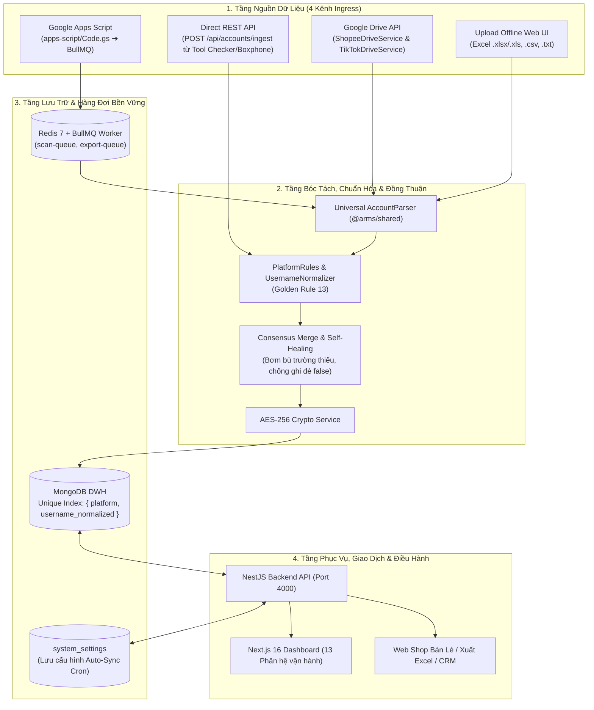

# TÀI LIỆU KIẾN TRÚC, THIẾT KẾ NÂNG CẤP & KIỂM TOÁN TOÀN DIỆN HỆ THỐNG ARMS DATA WAREHOUSE

> **Phiên bản hệ thống:** ARMS Enterprise MMO Data Warehouse v4.0  
> **Cập nhật sau đợt rà soát & khắc phục:** 14/11/2026  
> **Kiến trúc Monorepo:** `packages/shared` (Lõi Parser/Rules/Schemas) • `apps/api` (NestJS Port 4000) • `apps/worker` (BullMQ Redis Port 6380) • `apps/web` (Next.js 16 Port 3000) • `apps-script/Code.gs`

---

## 1. TỔNG QUAN KIẾN TRÚC DATA WAREHOUSE (SINGLE SOURCE OF TRUTH)

ARMS Data Warehouse là kho dữ liệu tập trung (DWH) tiếp nhận toàn bộ tài khoản MMO (**Shopee, TikTok, Facebook, Mail**) và lịch sử tiêu thụ/giao dịch từ mọi công cụ ngoại vi, bảng tính Google Sheets, file Excel offline và luồng đồng bộ Google Drive.

---

## 2. DANH MỤC TOÀN BỘ CÁC ĐẦU API (FULL API ENDPOINTS REFERENCE)

Tất cả API (trừ `POST /auth/login` và các route dùng HMAC/API Key riêng của `integrations/google-sheets`) đều được bảo vệ qua `JwtAuthGuard` và `RolesGuard` (hoặc `x-arms-service-key` cho tích hợp máy-tới-máy).

### 2.1. Phân hệ Kho Tài Khoản & Giao Dịch (`apps/api/src/modules/accounts/accounts.controller.ts` — Prefix `/accounts`)
| Method | Endpoint | Phân quyền (`@Roles`) | Chức năng & Ghi chú kỹ thuật |
| :--- | :--- | :--- | :--- |
| `GET` | `/accounts/stats` | Đã đăng nhập | Thống kê tổng quan Dashboard (đã loại trừ `TRASH` khỏi `total`, `by_platform`, `quality`) |
| `GET` | `/accounts/analytics` | `OWNER`, `MANAGER` | Alias trả về phân tích kho `getAnalyticsSummary()` |
| `GET` | `/accounts/crm/stats` | `OWNER`, `MANAGER` | Thống kê CRM doanh thu ước tính, Top khách hàng, Đơn hàng theo `order_id` |
| `GET` | `/accounts` | Đã đăng nhập | Truy vấn kho đa bộ lọc (`platform`, `status`, `data_quality`: `full_info`/`has_cookie`/`has_token`/`has_email`/`missing_core`/`corrupted`, `machine_id`, `date_from`/`date_to`, `search`, `tags`) |
| `GET` | `/accounts/:username` | Đã đăng nhập | Xem chi tiết 1 tài khoản (tự giải mã password/cookie/token theo role) |
| `POST` | `/accounts` | `OWNER`, `MANAGER`, `MEMBER` | Tạo thủ công 1 tài khoản lẻ từ Web UI |
| `PATCH` | `/accounts/:username` | `OWNER`, `MANAGER` | Cập nhật thông tin, mật khẩu, cookie, trạng thái tài khoản |
| `DELETE` | `/accounts/:username` | `OWNER`, `MANAGER` | Xóa mềm 1 tài khoản vào Thùng Rác (`TRASH`) |
| `POST` | `/accounts/bulk-sold` | `OWNER`, `MANAGER` | Chốt giao dịch bán hàng loạt (`usernames`, `sold_to`, `order_id`, `unit_price`) |
| `POST` | `/accounts/bulk-used` | `OWNER`, `MANAGER` | Đánh dấu hàng loạt đã đưa vào sử dụng (`USED`) |
| `POST` | `/accounts/bulk-blacklist` | `OWNER`, `MANAGER` | Khóa hàng loạt sang `BLACKLISTED` |
| `POST` | `/accounts/bulk-delete` | `OWNER`, `MANAGER` | Chuyển hàng loạt vào Thùng Rác (`TRASH`) |
| `POST` | `/accounts/trash/restore` | `OWNER`, `MANAGER` | Khôi phục hàng loạt từ `TRASH` về `AVAILABLE` |
| `POST` | `/accounts/trash/empty` | `OWNER` | Dọn sạch vĩnh viễn toàn bộ tài khoản trong `TRASH` |
| `GET` | `/accounts/export/excel` | Đã đăng nhập | Streaming xuất Excel `.xlsx` theo đúng bộ lọc đang xem (tự giải mã AES-256) |
| `POST` | `/accounts/ingest` | Đã xác thực / Service Key | Nạp batch JSON tốc độ cao (`bulkWrite`), bảo vệ nick đã `SOLD`/`USED`, giữ khóa `{ platform, username_normalized }` |

### 2.2. Phân hệ Cứu Hộ & Tự Chữa Lành (`accounts.controller.ts` — Prefix `/accounts`)
| Method | Endpoint | Phân quyền (`@Roles`) | Chức năng |
| :--- | :--- | :--- | :--- |
| `GET` | `/accounts/sanitation/stats` | `OWNER`, `MANAGER` | Đếm số lượng `corrupted`, `missing_core`, `blacklisted`, `duplicates`, `trash` |
| `POST` | `/accounts/sanitation/clean` | `OWNER`, `MANAGER` | Thực thi hàng loạt (`AUTO_FIX`, `DELETE`, `BLACKLIST`, `RESTORE`, `HARD_DELETE`) theo nhóm |
| `POST` | `/accounts/auto-fix` | `OWNER`, `MANAGER` | Cứu hộ & hợp nhất đồng thuận cho danh sách `usernames` chỉ định |

### 2.3. Phân hệ Quét File & Hàng Đợi (`apps/api/src/modules/scan/scan.controller.ts` — Prefix `/scan`)
| Method | Endpoint | Phân quyền (`@Roles`) | Chức năng |
| :--- | :--- | :--- | :--- |
| `POST` | `/scan/upload` | `OWNER`, `MANAGER` | Upload file Excel vào hàng đợi BullMQ (`scan-queue` ➔ `ScanProcessor`) |
| `POST` | `/scan/upload-offline` | `OWNER`, `MANAGER` | Xử lý file `.xlsx/.xls/.csv/.txt` chế độ `preview` / `commit` (đọc toàn bộ các sheet) |
| `GET` | `/scan/batches` | Đã đăng nhập | Danh sách lịch sử các lô quét (`ScanBatch`) |
| `GET` | `/scan/batches/:id` | Đã đăng nhập | Chi tiết thống kê theo từng sheet/tab của 1 batch |
| `GET` | `/scan/batches/:id/errors` | Đã đăng nhập | Danh sách các dòng lỗi (`row_errors`) của batch |

### 2.4. Phân hệ Tích Hợp Google Drive & Google Sheets (`apps/api/src/modules/integrations/*`)
| Controller | Method | Endpoint | Xác thực / Phân quyền | Chức năng |
| :--- | :--- | :--- | :--- | :--- |
| `ShopeeDriveController` | `GET` | `/integrations/shopee-drive/status` (và alias `/integrations/google-drive/status`) | Đã đăng nhập | Trạng thái OAuth, cấu hình `auto_sync_enabled`, tiến độ quét realtime |
| `ShopeeDriveController` | `GET` | `/integrations/shopee-drive/auth-url` | `OWNER`, `MANAGER` | Lấy link xác thực Google OAuth2 |
| `ShopeeDriveController` | `POST` | `/integrations/shopee-drive/sync-now` | `OWNER`, `MANAGER` | Kích hoạt chạy đồng bộ Shopee từ Google Drive |
| `ShopeeDriveController` | `POST` | `/integrations/shopee-drive/settings` | `OWNER`, `MANAGER` | Bật/tắt & lưu chu kỳ quét định kỳ bền vững vào MongoDB `system_settings` |
| `TikTokDriveController` | `GET` | `/integrations/tiktok-drive/status` | Đã đăng nhập | Trạng thái kết nối & tiến độ bóc tách kho TikTok từ Drive |
| `TikTokDriveController` | `POST` | `/integrations/tiktok-drive/sync-now` | `OWNER`, `MANAGER` | Kích hoạt đồng bộ kho TikTok từ Drive (đầy đủ `email_password_enc`) |
| `GoogleSheetsController` | `POST` | `/integrations/google-sheets/sync` | HMAC / `x-arms-api-key` | Nhận payload các tab từ Apps Script `Code.gs` và đưa vào `scan-queue` |
| `GoogleSheetsController` | `POST` | `/integrations/google-sheets/save-sheet-index` | HMAC / `x-arms-api-key` | Lưu danh mục Google Sheets phát hiện được vào `discovered_sheets` |
| `GoogleSheetsController` | `GET` | `/integrations/google-sheets/get-sheet-index` | HMAC / `x-arms-api-key` | Lấy danh mục Google Sheets đã lưu |

### 2.5. Các Phân Hệ Hỗ Trợ Khác (`exports`, `backup`, `audit`, `auth`, `users`, `teams`, `api-keys`)
- **Exports (`/exports`):** `POST /exports` (`OWNER`, `MANAGER`), `GET /exports`, `GET /exports/:id`, `GET /exports/:id/download` (`OWNER`, `MANAGER`).
- **Backup (`/backup`):** `POST /backup/create`, `GET /backup/list`, `GET /backup/download/:fileName` (`OWNER`, `MANAGER`); `POST /backup/restore/:fileName`, `DELETE /backup/:fileName` (`OWNER`).
- **Audit (`/audit-logs`):** `GET /audit-logs` (`OWNER`, `AUDITOR`, `MANAGER`, `VIEWER`), `GET /audit-logs/system-logs`.
- **Auth (`/auth`):** `POST /auth/login`, `GET /auth/me`.
- **Users (`/users`):** `GET /users` (`OWNER`, `MANAGER`), `POST /users`, `PATCH /users/:id`, `DELETE /users/:id` (`OWNER`), `GET /users/teams/list` (`OWNER`, `MANAGER`, `MEMBER`).
- **Teams (`/teams`):** `GET /teams`, `GET /teams/:code`, `POST /teams`, `PATCH /teams/:code` (`OWNER`, `MANAGER`), `DELETE /teams/:code` (`OWNER`).
- **API Keys (`/api-keys`):** `GET /api-keys` (`OWNER`, `MANAGER`), `POST /api-keys`, `DELETE /api-keys/:id` (`OWNER`).

---

## 3. DANH MỤC CÁC PAGE / PHÂN HỆ GIAO DIỆN FRONTEND (`apps/web/src/app/page.tsx`)

| Mã Tab (`activeTab`) | Tên Phân Hệ | Component Chính | Chức năng & Trải nghiệm Vận hành |
| :--- | :--- | :--- | :--- |
| `overview` | Tổng Quan BI | `DashboardOverview`, `SalesChart`, `PlatformDonut` | Theo dõi tồn kho hoạt động, tỷ trọng Shopee/TikTok, biểu đồ biến động |
| `accounts` | Kho Tài Khoản | `AccountFilters`, `AccountsTable`, `BulkActionBar`, `AccountDetailModal`, `AddAccountModal`, `SmartExportDialog` | Lọc đa tầng + **7 nút lọc nhanh 1-Click**, thao tác hàng loạt (Bán/Dùng/Blacklist/Xóa), copy 1-Click, xuất Excel |
| `ingress` | Drive Ingress Hub | `DriveIngressHub` | Bảng điều khiển đồng bộ Shopee & TikTok từ Google Drive theo thời gian thực + cấu hình quét định kỳ |
| `import` | Nạp File Offline | Form trong `page.tsx` | Chọn nền tảng đích (`SHOPEE`/`TIKTOK`/`FACEBOOK`), upload `.xlsx/.csv/.txt`, xem 5 thẻ **Preview phân loại bảo vệ** trước khi Commit |
| `lookup` | Tra Cứu Nhanh | Form trong `page.tsx` | Dán danh sách username hàng loạt để kiểm tra tồn kho, trạng thái bán và mật khẩu |
| `exports` | Lịch Sử Xuất Kho | `page.tsx` | Tạo & tải các gói xuất kho bất đồng bộ từ BullMQ `export-queue` |
| `farm` | Ma Trận Boxphone | `FarmMatrixView` | Giám sát mật độ tài khoản theo từng mã máy (`machine_id`: `p2k1`, `box 1`...) |
| `sanitation` | Trung Tâm Cứu Hộ | `AccountSanitationView` | Thống kê nick vi phạm Domain Rules, thiếu Core Info, Thùng Rác; kích hoạt **Cứu Hộ Hàng Loạt (Consensus Auto-Fix)** |
| `crm` | Doanh Thu & CRM | `CrmDashboardView` | Theo dõi đơn hàng bán ra (`order_id`), Top khách hàng và doanh thu ước tính |
| `backups` | Sao Lưu & Khôi Phục | `page.tsx` | Tạo snapshot MongoDB và phục hồi dữ liệu an toàn |
| `apikeys` | Quản Lý API Keys | `page.tsx` | Cấp phát và thu hồi `x-arms-service-key` cho các tool Python/Web Shop ngoại vi |
| `teams` | Đội Nhóm & Nhân Sự | `page.tsx` | Quản lý RBAC (`OWNER`, `MANAGER`, `MEMBER`, `VIEWER`, `AUDITOR`) và cô lập dữ liệu theo Team |
| `systemlogs` | Nhật Ký Hệ Thống | `SystemLogsView` | Theo dõi luồng log API, tiến trình quét và lịch sử Audit |

---

## 4. CÁC LỖI GỐC RỄ ĐÃ ĐƯỢC XỬ LÝ TRIỆT ĐỂ TRONG ĐỢT NÂNG CẤP NÀY

### 4.1. Chống Quét Sót (Zero-Miss Excel & Drive Ingestion)
1. **Đọc đa Sheet khi upload file Excel (`scan.service.ts`):** Trước đây chỉ đọc `workbook.worksheets[0]`. Đã nâng cấp duyệt qua **toàn bộ `workbook.worksheets`**, giữ nguyên `source_sheet` của từng tab và truyền vào `AccountParser.parseRow()`.
2. **Bảo toàn trường `platform` & `email_password_enc`:**
   - Sửa `AccountParser.parseRow` (nhánh ô lồng Pipe) không còn hardcode `'SHOPEE'` mà dùng đúng `platform` theo Quy tắc 13 (`default_platform`).
   - Bổ sung lưu `email_password_enc` trong `TikTokDriveService` (trước đây đã mã hóa nhưng quên gán vào `setFields`).
   - Sửa `ScanProcessor` (Worker BullMQ) gán `username = parsed.username`, bổ sung `phone`, `coins`, `raw`, và khóa kép `{ platform, username_normalized }`.
3. **Mở rộng dải đọc Google Sheets (`shopee-drive.service.ts`):** Tăng vùng đọc Sheets API từ `!A1:Z3000` lên `!A1:Z50000` để không bỏ sót các file nhiều hơn 3.000 dòng.
4. **Bảo vệ trạng thái đã bán (`accounts.service.ts` - `ingestAccounts`):** Chuyển từ vòng lặp `updateOne` tuần tự sang `bulkWrite`, đưa `status: 'AVAILABLE'` vào `$setOnInsert` để khi tool ngoài đẩy lại nick đã `SOLD`/`USED` không bị reset về `AVAILABLE`.

### 4.2. Quét Định Kỳ Bền Vững (Persistent Auto-Sync)
- **Trước đây:** Biến `autoSyncEnabled` và `syncIntervalMinutes` trong `ShopeeDriveService` chỉ lưu trên RAM — mỗi lần restart server là mất lịch quét định kỳ.
- **Khắc phục:** `ShopeeDriveService` hiện implement `OnModuleInit` để lưu và khôi phục cấu hình `{ key: 'drive_auto_sync', auto_sync_enabled, sync_interval_minutes }` từ collection `system_settings` trong MongoDB. Khi server khởi động lại, chu kỳ quét tự động được kích hoạt lại ngay lập tức.

### 4.3. Chống Sai Số Thống Kê (Zero-Discrepancy Counting)
- **Trước đây:** `getAnalyticsSummary()` đếm cả các bản ghi ở trạng thái `TRASH` vào `total`, `by_platform` và `quality`, gây lệch số liệu so với Bảng Kho (`findAll` lọc bỏ `TRASH`). Đồng thời `getMissingCoreMongoFilter` đếm cả nick đã `BLACKLISTED`/`TRASH` và bỏ qua `token_enc`/`session_token` của TikTok.
- **Khắc phục:**
  - `getAnalyticsSummary()` lọc `{ status: { $ne: 'TRASH' } }` cho tổng kho, theo nền tảng và chất lượng; vẫn giữ đếm `TRASH` riêng trong `by_status`.
  - `PlatformRules.getMissingCoreMongoFilter()` loại trừ `BLACKLISTED`/`TRASH` và kiểm tra đủ 4 trường core (`password_enc`, `cookie_enc`, `token_enc`, `session_token`).
  - Đồng bộ hóa bộ lọc `data_quality` (`full_info`, `has_cookie`, `has_token`, `has_email`, `missing_core`, `corrupted`) giữa `AccountsService` và `AccountsExportService`.

### 4.4. Cơ Chế Đồng Thuận & Tự Chữa Lành (Consensus Self-Healing Engine)
- **Cộng dồn chất lượng khi quét từ nhiều nguồn (`ShopeeDriveService`, `TikTokDriveService`, `ScanService`, `ScanProcessor`, `AccountsService`):** Chỉ bật cờ `quality.has_cookie = true` / `has_token = true` / `has_email = true` khi lần quét mới có dữ liệu thực; **tuyệt đối không ghi đè `false` lên cờ `true` đã có từ nguồn trước**.
- **Hợp nhất Đồng Thuận khi Cứu Hộ (`AccountsSanitationService.autoFixByFilter`):** Khi phục hồi một bản ghi bị lệch cột/lỗi username và phát hiện username sau khi bóc tách đã tồn tại trên bản ghi chính trong kho, hệ thống tự động đối chiếu từng trường (`password_enc`, `cookie_enc`, `token_enc`, `session_token`, `email`, `email_password_enc`, `phone`, `machine_id`, `coins`), **bơm toàn bộ thông tin còn thiếu sang bản ghi chính** và ghi lịch sử `CONSENSUS_HEALED_FROM_DUPLICATE`, sau đó mới cô lập bản sao sang `BLACKLISTED` với tên `dup_<user>_<id4>`.

### 4.5. Cải Tiến Giao Diện & Đồng Bộ DTO Frontend (`apps/web`)
- Sửa lỗi lệch DTO tại màn hình **Nạp File Offline (`page.tsx`)** đọc đúng `summary.total_parsed`, `details.inserted`, `details.updated`, và bổ sung **5 thẻ thống kê Preview trực quan** (Tổng phân tích, Thêm mới, Cập nhật đồng thuận, Bảo vệ nick Đã Bán/Dùng, Dòng lỗi) trước khi xác nhận ghi DB.
- Nâng cấp thanh lọc nhanh **1-Click Operational Chips** tại `AccountFilters.tsx`, bổ sung ngay các nút lọc `🍪 Có Cookie`, `🔑 Có Token`, `📧 Có Email`, `⚪ Thiếu Pass&Cookie` bên cạnh `🟢 Sẵn Sàng`, `✨ Full Info`, `⚠️ Nick Lỗi` và `🗑️ Thùng Rác`.
