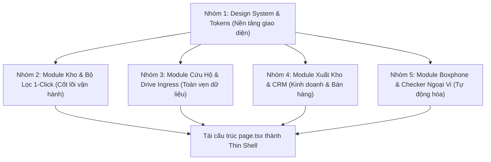

# KẾ HOẠCH PHÂN RÃ & CHUẨN HÓA KIẾN TRÚC GIAO DIỆN DOANH NGHIỆP
## ARMS ENTERPRISE UI MODULAR ROADMAP (V4.2)
**Hệ thống:** ARMS Data Warehouse & MMO Automation Hub  
**Phân hệ:** `apps/web` (Next.js 15, Tailwind CSS, TypeScript)  
**Kiến trúc sư:** Enterprise UI/UX Architect  
**Ngày phê duyệt tài liệu:** 15/11/2026  
**Trạng thái:** SẴN SÀNG THI CÔNG THEO PHÂN NHÓM ĐỘC LẬP  

---

## 1. TỔNG QUAN HIỆN TRẠNG & NỢ KỸ THUẬT (TECHNICAL DEBT AUDIT)

### 1.1. Thực trạng "God Component" tại `apps/web/src/app/page.tsx`
Qua quá trình rà soát toàn diện mã nguồn giao diện tại `apps/web`, phát hiện tệp `page.tsx` đang gánh chịu khoản nợ kỹ thuật (Technical Debt) rất lớn:
- **Quy mô phình to quá tải:** Tệp `page.tsx` hiện có độ dài **1.972 dòng mã**.
- **Ôm đồm hơn 30 React States:** Từ Theme, Auth token, Pagination, Filter kho, đến các trạng thái nội tại của 7 phân hệ độc lập (Offline Import, Duplicate Scanner, Quick Lookup, File Exports, Database Backups, Tool API Keys, Team RBAC, System Live Logs).
- **Trộn lẫn 6 phân hệ JSX inline:** Các chức năng sau **chưa hề có component riêng** mà bị viết trực tiếp vào thân `page.tsx`:
  1. *Offline Import & Duplicate Scanner* (`tab === 'import'`): Dòng 1196 – 1355.
  2. *Quick Lookup Tool* (`tab === 'lookup'`): Dòng 1356 – 1428.
  3. *Export Center* (`tab === 'exports'`): Dòng 1429 – 1541.
  4. *Backups & Snapshots* (`tab === 'backups'`): Dòng 1593 – 1673.
  5. *API Keys Management* (`tab === 'apikeys'`): Dòng 1674 – 1835.
  6. *Teams & RBAC Management* (`tab === 'teams'`): Dòng 1836 – 1963.
  7. *Màn hình Đăng nhập (Auth Form)*: Dòng 924 – 1100 bị code inline thay vì tách thành `AuthView.tsx`.
- **Hiệu năng suy giảm (Re-render Cascades):** Khi người vận hành gõ ký tự vào ô tìm kiếm hoặc toggle một checkbox, toàn bộ cây DOM khổng lồ của `page.tsx` (gần 2000 dòng) bị kích hoạt tính toán lại, gây hiện tượng khựng nhẹ (input latency) trên các trình duyệt vận hành nhiều tab.

### 1.2. Thẩm mỹ "AI Prototype Gradient" & Thiếu tương phản (Low Contrast)
- **Gradient lòe loẹt, thiếu tính Enterprise:** Sử dụng quá mức các dải gradient đa sắc phong cách AI thô (`bg-gradient-to-r from-cyan-500 to-pink-500`, `from-purple-600 to-indigo-600`, `from-amber-500 to-orange-500`), tạo cảm giác ứng dụng demo không trang trọng.
- **Trôi màu & Mờ nhạt ở Light Mode:** Các nút bấm và thẻ sử dụng `bg-white/5`, `border-[var(--border-subtle)]` hoặc `text-desc` (`#64748b`) trên nền sáng khiến người dùng gần như không nhận diện được đường viền và trạng thái nút bấm (đặc biệt trong môi trường văn phòng nhiều ánh sáng).
- **Mật độ dữ liệu thấp (Low Density):** Padding các hàng trong bảng (`py-3.5`) quá thưa, lãng phí không gian hiển thị danh sách tài khoản quy mô hàng trăm nghìn bản ghi.

### 1.3. Trùng lặp Header & Tiêu đề
- Thanh điều hướng trên cùng (`TopBar.tsx`) đã hiển thị tên và mô tả tab (ví dụ: *"Trung Tâm Cứu Hộ & Dọn Dẹp Dữ Liệu"*, *"Trung Tâm Điều Hành Kéo Dữ Liệu Google Drive"*), nhưng bên trong các component con (`AccountSanitationView.tsx`, `DriveIngressHub.tsx`) lại tiếp tục render tiêu đề to lặp lại, làm mất từ 80px đến 120px chiều cao màn hình làm việc quý giá.

### 1.4. Dữ liệu giả định (Mock Data) & Ngôn ngữ phi chuẩn
- Phân hệ Boxphone (`FarmMatrixView.tsx`) dùng lệnh `setTimeout` 1.2 giây giả lập quét thiết bị nội bộ, không liên kết API thực tế.
- Tồn tại các chuỗi văn bản thiếu chuẩn mực doanh nghiệp: *"Bảo đảm an toàn 100%"*, *"Chuẩn hóa 100%"*, *"Khách_Le"*, *"Dàn Boxphone Thật"*.

---

## 2. BẢNG ĐỐI CHIẾU KIẾN TRÚC HIỆN TRẠNG VÀ MỤC TIÊU (GAP ANALYSIS)

| Tiêu Chí Đánh Giá | Hiện Trạng (As-Is) | Mục Tiêu Chuẩn Doanh Nghiệp (To-Be) |
| :--- | :--- | :--- |
| **Kiến trúc Tệp gốc** | `page.tsx` là God Component (1.972 dòng), chứa toàn bộ API calls & state. | `page.tsx` tinh gọn dưới 180 dòng, đóng vai trò Router/Shell nạp Lazy Modules theo Tab. |
| **Phân rã Domain** | 6 tab quan trọng bị code inline trong JSX của `page.tsx`. | Tách 100% thành các Module thư mục độc lập trong `src/modules/`. |
| **Quản lý State** | 30+ `useState` tập trung tại root, re-render diện rộng. | Từng Module tự quản lý state hoặc thông qua Custom Hooks độc lập (`useAccounts`, `useSanitation`). |
| **Đồng bộ URL** | URL Hash chỉ lưu tên tab (`#accounts`), mất sạch bộ lọc khi F5. | Đồng bộ 2 chiều qua URL Hash & SearchParams (`#accounts?platform=SHOPEE&status=AVAILABLE`). |
| **Phong cách Thiết kế** | Gradient AI lòe loẹt, viền mờ nhạt, chìm màu ở Light Mode. | Linear / Vercel Enterprise Design System: High Contrast, viền sắc nét `border-slate-200 dark:border-slate-800`. |
| **Typography** | Cỡ chữ không phân cấp chuẩn, thiếu font monospace cho dữ liệu kỹ thuật. | Chuẩn hóa `text-xs`, `text-[11px]`, `font-mono` cho Username, Password, Token, Cookie, Machine ID. |
| **Mật độ Bảng (Density)** | Compact kém (`py-3.5`), chỉ xem được 7–8 dòng trên màn 1080p. | High-Density Compact Table (`py-1.5 px-2.5`), hiển thị 18–22 dòng trên một màn hình. |
| **Ngôn ngữ Nghiệp vụ** | Từ ngữ cợt nhả, hứa hẹn cảm tính (*"Thật 100%", "Khách_Le"*). | Thuật ngữ chuẩn ERP/Fintech: *"Tài nguyên khả dụng", "Khách lẻ/Đối tác sỉ", "Chuẩn hóa hoàn chỉnh"*. |
| **Phân hệ Ngoại vi** | Mock giả lập tĩnh (`setTimeout` không có thiết bị thật). | ADB Native Integration Empty State chuẩn kỹ thuật + Phân hệ Shopee Checker điều phối luồng live. |

---

## 3. KIẾN TRÚC THƯ MỤC ĐÍCH (TARGET DIRECTORY STRUCTURE)

Cấu trúc mới được phân định ranh giới nghiệp vụ chặt chẽ theo **Domain-Driven Design (DDD)**:

```
apps/web/src/
├── app/
│   ├── globals.css                # Enterprise Tokens, High-Contrast Variables
│   ├── layout.tsx                 # Root layout & Metadata
│   └── page.tsx                   # Thin App Shell & Dynamic Module Switcher (<180 dòng)
│
├── design-system/                 # Nhóm 1: Enterprise Design Tokens & Core Primitives
│   ├── tokens.ts                  # Bảng màu sắc nét, borders, spacing chuẩn
│   ├── Button.tsx                 # Nút bấm High-Contrast (Solid, Outline, Ghost, Danger)
│   ├── Badge.tsx                  # Chip nhãn trạng thái chuẩn xác, không mờ nhạt
│   ├── Input.tsx                  # Input & Select sắc nét cho Dark/Light
│   └── CompactCard.tsx            # Thẻ nội dung mật độ cao, không gradient tím/hồng
│
├── modules/
│   ├── accounts/                  # Nhóm 2: Phân hệ Quản trị Kho Tài Khoản
│   │   ├── AccountsModule.tsx     # Container chính của kho tài khoản
│   │   ├── useAccounts.ts         # Custom Hook quản lý query, filter, pagination
│   │   ├── AccountFilters.tsx     # Bộ lọc 1-Click theo Platform & Quality
│   │   ├── AccountsTable.tsx      # Bảng mật độ cao (High Density Table)
│   │   ├── BulkActionBar.tsx      # Thanh công cụ nổi thao tác hàng loạt
│   │   ├── AccountDetailModal.tsx # Modal soi chi tiết tài khoản & cookie
│   │   └── AddAccountModal.tsx    # Modal nhập tài khoản thủ công lẻ
│   │
│   ├── sanitation/                # Nhóm 3: Phân hệ Cứu hộ & Dọn dẹp Rác Kho
│   │   ├── SanitationModule.tsx   # Triệt tiêu trùng lặp header, bảng điều khiển tinh gọn
│   │   ├── useSanitation.ts       # Hook gọi API quét vi phạm Domain Rules & Auto-Fix
│   │   └── ViolationCard.tsx      # Thẻ phân loại vi phạm chuẩn độ tương phản cao
│   │
│   ├── ingress/                   # Nhóm 3: Phân hệ Kéo Dữ liệu Google Drive & Sheets
│   │   ├── DriveIngressModule.tsx # Hub điều phối tập trung Drive Ingress
│   │   ├── ShopeeDriveTab.tsx     # Kênh kéo Sheets/Excel Shopee
│   │   ├── TiktokDriveTab.tsx     # Kênh kéo Sheets/Excel TikTok
│   │   └── AutoSyncConfigTab.tsx  # Cấu hình chu kỳ Cronjob tự động quét
│   │
│   ├── commercial/                # Nhóm 4: Phân hệ Xuất kho & Kinh doanh (CRM)
│   │   ├── CrmModule.tsx          # Bảng điều khiển doanh thu, khách hàng & công nợ
│   │   ├── SmartExportDialog.tsx  # Hộp thoại trích xuất định dạng & tạo hóa đơn
│   │   ├── ExportsHistoryTab.tsx  # Lịch sử và tải lại các gói xuất file cũ
│   │   └── OfflineImportTab.tsx   # Nhập file TXT/Excel trực tiếp & chống trùng lặp
│   │
│   ├── devices-checker/           # Nhóm 5: Phân hệ Thiết bị Boxphone & Shopee Checker
│   │   ├── BoxphoneFarmModule.tsx # Giám sát dàn máy thật qua cổng ADB 5037
│   │   ├── ShopeeCheckerTab.tsx   # Phân hệ điều phối kiểm tra Live/Die & Cookie
│   │   └── AdbTerminalView.tsx    # Console đối soát kết nối phần cứng ADB Daemon
│   │
│   ├── system/                    # Phân hệ Hạ tầng & Quản trị Hệ thống
│   │   ├── QuickLookupModule.tsx  # Tra cứu tức thì danh sách Username
│   │   ├── BackupsModule.tsx      # Sao lưu Snapshot MongoDB & khôi phục 1-click
│   │   ├── ApiKeysModule.tsx      # Cổng phát hành Service Keys cho tool bot
│   │   ├── TeamsModule.tsx        # Phân quyền RBAC & cô lập dữ liệu theo nhóm
│   │   ├── SystemLogsModule.tsx   # Luồng Terminal log trực tiếp thời gian thực
│   │   └── AuthModal.tsx          # Màn hình đăng nhập tài khoản ARMS độc lập
│   │
│   └── layout/                    # Thành phần khung ứng dụng
│       ├── Sidebar.tsx            # Thanh điều hướng phân cấp rõ ràng
│       └── TopBar.tsx             # Thanh trạng thái & thông tin tài khoản
│
└── lib/
    ├── api.ts                     # Wrapper API Client
    └── url-sync.ts                # Tiện ích đồng bộ hóa URL State 2 chiều
```

---

## 4. CHI TIẾT KẾ HOẠCH THI CÔNG 5 NHÓM MODULE ĐỘC LẬP



---

### NHÓM 1: CHUẨN HÓA ENTERPRISE DESIGN SYSTEM & TYPOGRAPHY
*Mục tiêu: Xóa bỏ hoàn toàn phong cách AI gradient lòe loẹt; thiết lập hệ thống màu High-Contrast sắc nét cho cả Dark/Light mode theo phong cách Linear/Vercel.*

#### 1. Quy chuẩn Bảng màu & Độ tương phản (High Contrast Tokens)
- **Cơ sở màu Dark Mode:**
  - Nền chính: `#09090b` (Slate-950 siêu sâu), Nền Card: `#0f172a` hoặc `#111827`.
  - Đường viền: `border-slate-800` (sắc nét, rõ ràng, không dùng border glow tím mờ).
  - Màu chữ: Tiêu đề `#f8fafc` (Slate-50), Nội dung `#cbd5e1` (Slate-300), Chú thích `#94a3b8` (Slate-400).
- **Cơ sở màu Light Mode:**
  - Nền chính: `#f8fafc` (Slate-50), Nền Card: `#ffffff` (White chuẩn).
  - Đường viền: `border-slate-200` và `border-slate-300` (rõ viền, không để mất biên giới giữa các card).
  - Màu chữ: Tiêu đề `#0f172a` (Slate-900), Nội dung `#334155` (Slate-700), Chú thích `#64748b` (Slate-500).
- **Triệt tiêu toàn diện Gradient lòe loẹt:**
  - Thay thế các class `bg-gradient-to-r from-purple-600 to-indigo-600` bằng Solid Buttons hoặc Neutral Subtle Buttons:
    + Nút Primary: `bg-slate-900 text-white hover:bg-slate-800 dark:bg-slate-100 dark:text-slate-900 dark:hover:bg-slate-200` (Vercel style).
    + Nút Success: `bg-emerald-600 text-white hover:bg-emerald-500 dark:bg-emerald-500 dark:text-slate-950`.
    + Nút Danger: `bg-rose-600 text-white hover:bg-rose-500 dark:bg-rose-500 dark:text-slate-950`.
    + Nút Secondary: `bg-white dark:bg-slate-800 text-slate-800 dark:text-slate-200 border border-slate-300 dark:border-slate-700 hover:bg-slate-100 dark:hover:bg-slate-700`.

#### 2. Quy chuẩn Typography & Mật độ hiển thị (Micro-spacing)
- **Hệ thống phân cấp cỡ chữ:**
  - Tiêu đề Card / Header: `text-xs font-bold uppercase tracking-wider` hoặc `text-sm font-bold`.
  - Nhãn bộ lọc / Nút bấm: `text-xs font-medium` hoặc `text-[11px] font-semibold`.
  - Dữ liệu bảng / Giá trị trường: `text-xs font-normal` kết hợp `font-mono` cho các chuỗi mã.
  - Chú thích phụ (Meta info): `text-[10px] text-slate-500 dark:text-slate-400 font-medium`.
- **Bắt buộc sử dụng Monospace Font:**
  - Áp dụng `font-mono` cho toàn bộ các trường: Username, Password, Token phiên, Session Cookie, Machine ID, Order ID, Timestamp, Port ADB, Dung lượng file, Địa chỉ IP.
- **Quy chuẩn Padding & Spacing:**
  - Card padding: Tối đa `p-3.5` đến `p-4` (thay thế cho `p-6`, `p-8` lãng phí).
  - Khoảng cách giữa các phần tử: `gap-2` hoặc `gap-3`.

#### 3. Checklist Thực Thi Nhóm 1
- [ ] Cập nhật tệp `apps/web/src/app/globals.css`: Thiết lập biến CSS gốc (`--border-subtle`, `--bg-card`, `--text-primary`) với hệ số tương phản đạt chuẩn WCAG AA (>4.5:1).
- [ ] Xây dựng thư viện component nguyên tử tại `src/design-system/`:
  - [ ] `Button.tsx`: Các biến thể `primary`, `secondary`, `outline`, `danger`, `ghost` sắc nét ở cả 2 theme.
  - [ ] `Badge.tsx`: Nhãn trạng thái (AVAILABLE, SOLD, USED, ERROR, BLACKLIST) không bị mờ nhạt.
  - [ ] `CompactInput.tsx`: Ô nhập liệu có focus border rõ nét.
- [ ] Rà soát loại bỏ hoàn toàn các dải gradient tím/hồng/cam trong `Sidebar.tsx`, `TopBar.tsx`, `DashboardOverview.tsx`.

---

### NHÓM 2: PHÂN RÃ MODULE QUẢN TRỊ KHO & BỘ LỌC 1-CLICK (INVENTORY DOMAIN)
*Mục tiêu: Độc lập hóa kho tài khoản thành module tự trị; tối ưu bảng mật độ cao và liên kết URL State mượt mà.*

#### 1. Thiết kế Module `AccountsModule.tsx` & Hook `useAccounts.ts`
- **Tách khỏi `page.tsx`:** Toàn bộ logic quản lý danh sách tài khoản, chọn hàng loạt, phân trang, gán nhãn được gom vào `apps/web/src/modules/accounts/`.
- **Custom Hook `useAccounts.ts`:**
  - Quản lý các biến state: `accounts`, `total`, `page`, `filters`, `selectedUsernames`, `loading`.
  - Tự động debounce 300ms khi người dùng nhập từ khóa tìm kiếm.
  - Đồng bộ trạng thái bộ lọc vào URL Hash & Query Parameters (ví dụ: `#accounts?platform=TIKTOK&status=AVAILABLE&page=2`). Khi người dùng copy link gửi đồng đội hoặc tải lại trang, toàn bộ bộ lọc và trang hiện tại được giữ nguyên vẹn.

#### 2. Bộ Lọc 1-Click Thực Chiến (Pragmatic MMO Filters)
- **Bộ chuyển đổi Nền Tảng (Subsystem Switcher):**
  - Chuyển từ gradient lòe loẹt sang các Tab pill phẳng, sắc nét:
    + `TẤT CẢ KHO` (`ALL`)
    + `SHOPEE` (Icon cam nhẹ, nhãn rõ ràng)
    + `TIKTOK` (Icon cyan nhẹ)
    + `FACEBOOK` (Icon blue)
    + `HÒM MAIL` (Icon indigo)
- **Hàng 1-Click Presets theo Rule 9 (Pragmatic UI):**
  - Giữ nguyên cơ chế 1-click thao tác nhanh nhưng tinh chỉnh giao diện nhỏ gọn:
    + 🟢 **Sẵn Sàng (AVAILABLE)**
    + ✨ **Full Info (Có Pass + Cookie)**
    + 🍪 **Có Cookie Sống**
    + 🔑 **Có Token Boxphone**
    + 📧 **Có Hòm Mail**
    + ⚪ **Nick Thiếu (Trắng Pass & Cookie)**
    + ⚠️ **Cần Cứu Hộ / Rác**
    + 🗑️ **Thùng Rác (TRASH)**

#### 3. Bảng Dữ Liệu Mật Độ Cao (High-Density Compact Table)
- **Giảm chiều cao hàng (Row Height):** Giảm padding từ `py-3.5` xuống `py-1.5 px-2.5`, nâng số lượng tài khoản nhìn thấy từ 8 dòng lên 20+ dòng trên màn hình tiêu chuẩn.
- **Sticky Table Header:** Cố định tiêu đề bảng khi cuộn trang danh sách dài, giúp thao tác chọn checkbox hàng đầu luôn sẵn sàng.
- **Hiển thị trực quan dữ liệu kỹ thuật:**
  - Cột Username: Hiển thị kèm huy hiệu nền tảng thu nhỏ.
  - Cột Password: Mask tự động dạng `••••••••`, click 1 lần để copy nhanh hoặc mở mắt xem.
  - Cột Cookie / Token: Huy hiệu màu nhỏ báo trạng thái `Cookie (OK)` hoặc `No Cookie`.
- **Bulk Action Bar:** Thanh thao tác hàng loạt nổi (Floating Bar) xuất hiện êm ái dưới đáy màn hình khi có ít nhất 1 tài khoản được chọn, hỗ trợ các thao tác an toàn: *Copy User:Pass, Đánh dấu Đã bán, Đổi mật khẩu, Chuyển vào Thùng rác, Cứu hộ tự động*.

#### 4. Checklist Thực Thi Nhóm 2
- [ ] Khởi tạo thư mục `apps/web/src/modules/accounts/`.
- [ ] Xây dựng hook `useAccounts.ts` với đầy đủ tính năng Fetch, Cache nhẹ và URL Sync.
- [ ] Di chuyển và chuẩn hóa `AccountFilters.tsx`, `AccountsTable.tsx`, `BulkActionBar.tsx`, `AccountDetailModal.tsx`, `AddAccountModal.tsx` vào thư mục module.
- [ ] Tối ưu hóa CSS bảng dữ liệu đạt mật độ hiển thị cao (High-Density), bổ sung tooltip sao chép 1-click.
- [ ] Kiểm thử tích hợp: Đảm bảo thao tác lọc, chuyển trang, chọn hàng loạt mượt mà không làm rung lắc giao diện.

---

### NHÓM 3: CHUẨN HÓA MODULE CỨU HỘ & DỌN RÁC (SANITATION) & DRIVE INGRESS
*Mục tiêu: Xóa bỏ hoàn toàn hiện tượng trùng lặp tiêu đề với TopBar; nút bấm tương phản cao ở cả Light/Dark mode; cấu trúc bảng điều khiển cứu hộ dữ liệu chuẩn mực.*

#### 1. Tinh Gọn Module Cứu Hộ & Dọn Rác (`SanitationModule.tsx`)
- **Triệt tiêu trùng lặp Header:**
  - Vì thanh điều hướng `TopBar.tsx` đã hiển thị: *"Trung Tâm Cứu Hộ & Dọn Dẹp Dữ Liệu"*, component `SanitationModule.tsx` bên dưới lập tức đi thẳng vào thanh trạng thái quét Domain Scanner, loại bỏ các khối banner giải thích dài dòng gây mất diện tích.
- **Phân loại Thẻ Vi Phạm (Violation Cards) sắc nét:**
  - Thay vì viền mờ nhạt, áp dụng bảng màu tương phản rõ rệt:
    + Thẻ 1: **Vi Phạm Domain Rules (Token làm User, STT Excel rác)** – Khung viền `border-rose-400 dark:border-rose-700`, nền cảnh báo rõ ràng.
    + Thẻ 2: **Tài Khoản Trắng (Mất cả Pass lẫn Cookie)** – Khung viền `border-amber-400 dark:border-amber-700`.
    + Thẻ 3: **Tài Khoản Trùng Lặp (Duplicate Kho)** – Khung viền `border-blue-400 dark:border-blue-700`.
    + Thẻ 4: **Thùng Rác & Chờ Hủy (Trash Pool)** – Khung viền `border-slate-400 dark:border-slate-700`.
- **Nút Bấm Thao Tác An Toàn (High Contrast Action Buttons):**
  - Ở Light Mode: Các nút *Tải Lại, Cứu Hộ Dữ Liệu, Khóa Blacklist, Khôi Phục* phải có nền đặc hoặc viền đậm (`border-slate-300 text-slate-800 bg-white hover:bg-slate-50`), cấm tuyệt đối việc dùng `bg-white/5` gây tàng hình nút bấm.
  - Bắt buộc Modal Xác Nhận Hai Chiều (Two-Way Safety Guard) trước khi thực thi xóa vĩnh viễn hoặc Auto-Fix hàng loạt, có hiển thị rõ số lượng tài khoản bị ảnh hưởng.

#### 2. Chuẩn Hóa Phân Hệ Kéo Dữ Liệu Google Drive (`DriveIngressModule.tsx`)
- **Tổ chức 3 Sub-tabs chuyên biệt:**
  - Tab 1: **Kênh Shopee Drive:** Điều phối quét Sheets/Excel Shopee, giám sát log tiến trình live, nút kích hoạt đồng bộ rõ nét.
  - Tab 2: **Kênh TikTok Drive:** Kéo data TikTok độc lập, thừa kế `default_platform: 'TIKTOK'`, bảo đảm không làm đảo lộn kho Shopee.
  - Tab 3: **Cấu hình Quét Tự Động (Auto-Sync Scheduler):** Toggle bật/tắt định kỳ và cấu hình chu kỳ (15p, 30p, 60p) dạng chip bấm trực quan.
- **Tối ưu Luồng Polling Trạng Thái:**
  - Chỉ duy trì polling trạng thái (2.5 giây/lần) khi Ingress đang trong trạng thái chạy (`is_running === true`). Khi tác vụ dừng, giảm tần suất polling về 30 giây hoặc chuyển sang polling theo yêu cầu để tiết kiệm băng thông và CPU máy trạm.

#### 3. Checklist Thực Thi Nhóm 3
- [ ] Khởi tạo `src/modules/sanitation/` và chuyển giao `AccountSanitationView.tsx` thành `SanitationModule.tsx`.
- [ ] Xóa bỏ toàn bộ các thẻ tiêu đề trùng lặp với `TopBar.tsx`.
- [ ] Cập nhật độ tương phản cho toàn bộ nút bấm trong `SanitationModule.tsx` trên cả Light/Dark Mode.
- [ ] Khởi tạo `src/modules/ingress/` và phân tách `DriveIngressHub.tsx` thành các sub-components tinh gọn (`ShopeeDriveTab.tsx`, `TiktokDriveTab.tsx`, `AutoSyncConfigTab.tsx`).
- [ ] Kiểm tra cơ chế tự ngắt Polling khi không có tác vụ đồng bộ nền đang chạy.

---

### NHÓM 4: CHUẨN HÓA MODULE XUẤT KHO & KINH DOANH BÁN HÀNG (CRM & SMART EXPORT)
*Mục tiêu: Chuẩn hóa toàn bộ thuật ngữ kế toán/bán hàng; thiết kế form trích xuất tài khoản thanh thoát, trực quan.*

#### 1. Chuẩn Hóa Thuật Ngữ Nghiệp Vụ (Zero-Casual Wording Policy)
Tuyệt đối loại bỏ các từ ngữ mang tính cợt nhả hoặc không phù hợp với phần mềm doanh nghiệp:
- ❌ *"Bảo đảm an toàn 100%"* ➔  **"Bảo toàn toàn vẹn cơ sở dữ liệu"**.
- ❌ *"Chuẩn hóa 100%"* ➔  **"Chuẩn hóa hoàn chỉnh theo Domain Rules"**.
- ❌ *"Khách_Le"* ➔  **"Khách lẻ / Đơn vãng lai"**.
- ❌ *"Nick Đầy Đủ (Pass+Cookie)"* ➔  **"Tài khoản Full Thông Tin (Pass & Cookie)"**.
- ❌ *"Dàn Boxphone Thật"* ➔  **"Dàn thiết bị Boxphone vật lý"**.

#### 2. Tinh Chỉnh Hộp Thoại Xuất Kho (`SmartExportDialog.tsx`)
- **Bố cục Form 2 Cột Thanh Thoát:**
  - Cột trái: Cấu hình nguồn hàng (Nền tảng, Số lượng cần xuất, Bộ lọc chỉ lấy Nick Live).
  - Cột phải: Thông tin đơn hàng (Tên khách hàng / Đại lý, Đơn giá/tài khoản, Tổng giá trị đơn hàng tự động tính, Tự động chuyển trạng thái sang `SOLD`).
- **Xem Trước Dòng Xuất Thực Tế (Live Preview Pattern):**
  - Khi người vận hành chọn Preset định dạng (ví dụ: `User|Pass|Cookie` hoặc `User|Pass|Mail|PassMail`), hệ thống hiển thị ngay một dòng dữ liệu mẫu trực quan ngay bên dưới:
    `testuser_mmo|Password123!|SPC_F=abcd1234...`
  - Giúp người vận hành kiểm tra chắc chắn định dạng trước khi bấm nút tải file.

#### 3. Tách Phân Hệ Lịch Sử Xuất File & Quản Lý Đơn Hàng (CRM)
- Phân tách `activeTab === 'exports'` đang bị viết inline trong `page.tsx` thành `ExportsHistoryTab.tsx` riêng biệt.
- Kết nối chặt chẽ giữa lượt xuất kho từ `SmartExportDialog` với lịch sử đơn hàng trong `CrmDashboardView.tsx`.
- Tối ưu giao diện CRM: Thống kê doanh thu theo ngày/tháng, bảng xếp hạng khách hàng VIP, và danh sách đơn hàng có thể tra cứu ngược lại danh sách tài khoản đã xuất.

#### 4. Checklist Thực Thi Nhóm 4
- [ ] Khởi tạo thư mục `src/modules/commercial/`.
- [ ] Di chuyển và cấu trúc lại `SmartExportDialog.tsx` và `CrmDashboardView.tsx`.
- [ ] Tạo mới component `ExportsHistoryTab.tsx` để thay thế đoạn mã inline trong `page.tsx`.
- [ ] Rà soát toàn bộ chuỗi văn bản (strings), thay thế 100% các từ ngữ cợt nhả bằng thuật ngữ chuẩn mực.
- [ ] Bổ sung khung Live Preview dòng xuất vào `SmartExportDialog.tsx`.

---

### NHÓM 5: CHUẨN HÓA PHÂN HỆ THIẾT BỊ BOXPHONE & SHOPEE CHECKER
*Mục tiêu: Xóa sạch mock data; xây dựng Empty State chuẩn kỹ thuật ADB Daemon; xây dựng bảng điều khiển cho công cụ kiểm tra tài khoản (Shopee Checker).*

#### 1. Chuẩn Hóa Phân Hệ Thiết Bị Boxphone (`BoxphoneFarmModule.tsx`)
- **Xóa bỏ Mock Data:** Loại bỏ lệnh `setTimeout` 1200ms giả lập trong `FarmMatrixView.tsx`. Kết nối trực tiếp vào API endpoint kiểm tra cổng ADB máy chủ (`/farm/devices` hoặc `/farm/adb-status`).
- **Empty State Chuẩn Kỹ Thuật (Enterprise Technical Empty State):**
  - Khi chưa có thiết bị nào kết nối: Hiển thị thẻ kỹ thuật gồm:
    + Trạng thái ADB Daemon Host: `127.0.0.1:5037` (hoặc cấu hình IP LAN).
    + Nút bấm *Kiểm Tra Kết Nối Lại* gọi API thật.
    + Bảng checklist đối soát phần cứng: Cáp kết nối Hub USB 3.0, trạng thái USB Debugging trên Android, cấp quyền RSA key màn hình thiết bị.
- **Trường hợp Có Thiết Bị Kết Nối (Active Matrix):**
  - Hiển thị danh sách thiết bị dạng lưới thẻ nhỏ (Compact Grid): Mã thiết bị (Serial ADB), Brand/Model máy, Tỉ lệ Pin/Nhiệt độ, Tài khoản đang nuôi hiện tại, Nút đẩy sang Antidetect Browser.

#### 2. Xây Dựng Bảng Điều Khiển Shopee / TikTok Checker (`ShopeeCheckerTab.tsx`)
Nhằm phục vụ nhu cầu kiểm tra chất lượng nick hàng loạt, tạo giao diện điều phối công cụ Checker tích hợp:
- **Khu vực Nhập Dữ Liệu Kiểm Tra:** Hỗ trợ dán trực tiếp danh sách Username/Password/Cookie hoặc chọn nhanh tài khoản trực tiếp từ Kho `AVAILABLE`.
- **Cấu hình Chế Độ Kiểm Tra (Check Modes):**
  - 1-Click chọn chế độ:
    + *Check Live / Die (Đăng nhập)*
    + *Check Cookie Sống / Chết (Session Alive)*
    + *Check Số Dư Xu & Ví ShopeePay / SPayLater*
    + *Check Đơn Hàng Đang Giao*
- **Bảng Tiến Trình Thời Gian Thực (Live Progress Dashboard):**
  - Thanh tiến trình tổng thể (Progress Bar: % hoàn thành).
  - Bộ đếm thời gian thực: `Live: X`, `Die: Y`, `Cookie Lỗi: Z`, `Vướng Captcha: K`.
  - Danh sách log kiểm tra trực tiếp có thể xuất kết quả ra file TXT phân loại theo Live/Die.

#### 3. Checklist Thực Thi Nhóm 5
- [ ] Khởi tạo thư mục `src/modules/devices-checker/`.
- [ ] Viết lại `FarmMatrixView.tsx` thành `BoxphoneFarmModule.tsx`, triệt tiêu hoàn toàn mã giả lập `setTimeout`.
- [ ] Xây dựng component `ShopeeCheckerTab.tsx` với luồng điều phối tác vụ kiểm tra nick trực quan.
- [ ] Bổ sung khung điều khiển luồng đa luồng (Threads selector: 5, 10, 20 luồng đồng thời) và cấu hình Proxy/IP xoay (TMProxy, Tinsoft, Proxy IPv6).

---

## 5. TÁI CẤU TRÚC TỆP GỐC `apps/web/src/app/page.tsx` THÀNH THIN SHELL

Sau khi 5 nhóm hoàn thành phân rã, tệp `page.tsx` sẽ được rút gọn từ **1.972 dòng** xuống **dưới 180 dòng**.

### Mã nguồn kiến trúc mục tiêu của `page.tsx`:
```tsx
'use client';

import React, { useState, useEffect } from 'react';
import dynamic from 'next/dynamic';
import { api, getToken, getRole, getTeam, getDisplayName } from '../lib/api';
import { Sidebar, TabType } from '../components/layout/Sidebar';
import { TopBar } from '../components/layout/TopBar';
import { AuthModal } from '../modules/system/AuthModal';

// Dynamic Lazy Loading cho từng Domain Module (Tối ưu tốc độ tải ban đầu)
const DashboardOverview = dynamic(() => import('../components/dashboard/DashboardOverview').then(m => m.DashboardOverview));
const AccountsModule = dynamic(() => import('../modules/accounts/AccountsModule').then(m => m.AccountsModule));
const DriveIngressModule = dynamic(() => import('../modules/ingress/DriveIngressModule').then(m => m.DriveIngressModule));
const SanitationModule = dynamic(() => import('../modules/sanitation/SanitationModule').then(m => m.SanitationModule));
const CrmModule = dynamic(() => import('../modules/commercial/CrmModule').then(m => m.CrmModule));
const ExportsHistoryTab = dynamic(() => import('../modules/commercial/ExportsHistoryTab').then(m => m.ExportsHistoryTab));
const OfflineImportTab = dynamic(() => import('../modules/commercial/OfflineImportTab').then(m => m.OfflineImportTab));
const BoxphoneFarmModule = dynamic(() => import('../modules/devices-checker/BoxphoneFarmModule').then(m => m.BoxphoneFarmModule));
const ShopeeCheckerTab = dynamic(() => import('../modules/devices-checker/ShopeeCheckerTab').then(m => m.ShopeeCheckerTab));
const QuickLookupModule = dynamic(() => import('../modules/system/QuickLookupModule').then(m => m.QuickLookupModule));
const BackupsModule = dynamic(() => import('../modules/system/BackupsModule').then(m => m.BackupsModule));
const ApiKeysModule = dynamic(() => import('../modules/system/ApiKeysModule').then(m => m.ApiKeysModule));
const TeamsModule = dynamic(() => import('../modules/system/TeamsModule').then(m => m.TeamsModule));
const SystemLogsModule = dynamic(() => import('../modules/system/SystemLogsModule').then(m => m.SystemLogsModule));

export default function AppShell() {
  const [theme, setTheme] = useState<'dark' | 'light'>('dark');
  const [isLoggedIn, setIsLoggedIn] = useState(false);
  const [activeTab, setActiveTab] = useState<TabType>('overview');
  const [isSidebarCollapsed, setIsSidebarCollapsed] = useState(false);
  const [isMobileDrawerOpen, setIsMobileDrawerOpen] = useState(false);
  const [globalStats, setGlobalStats] = useState<any>(null);

  // Khởi tạo Auth & khôi phục URL Hash khi tải trang
  useEffect(() => {
    const savedTheme = (localStorage.getItem('arms_theme') as 'dark' | 'light') || 'dark';
    setTheme(savedTheme);
    document.documentElement.setAttribute('data-theme', savedTheme);

    const token = getToken();
    if (token) {
      setIsLoggedIn(true);
      const hash = window.location.hash.replace('#', '') as TabType;
      if (hash) setActiveTab(hash);
    }
  }, []);

  const handleTabChange = (newTab: TabType) => {
    setActiveTab(newTab);
    window.location.hash = newTab;
    localStorage.setItem('arms_active_tab', newTab);
  };

  if (!isLoggedIn) {
    return <AuthModal onLoginSuccess={() => setIsLoggedIn(true)} />;
  }

  return (
    <div className="flex h-screen w-screen overflow-hidden bg-[var(--bg-main)] text-[var(--text-primary)]">
      {/* Sidebar Điều Hướng */}
      <Sidebar
        activeTab={activeTab}
        setActiveTab={handleTabChange}
        userRole={getRole() || 'MEMBER'}
        userTeam={getTeam() || 'ALL'}
        userDisplayName={getDisplayName() || 'Thành Viên'}
        onLogout={() => { setIsLoggedIn(false); window.location.reload(); }}
        theme={theme}
        toggleTheme={() => {
          const next = theme === 'dark' ? 'light' : 'dark';
          setTheme(next);
          document.documentElement.setAttribute('data-theme', next);
          localStorage.setItem('arms_theme', next);
        }}
        isCollapsed={isSidebarCollapsed}
        setIsCollapsed={setIsSidebarCollapsed}
        isMobileOpen={isMobileDrawerOpen}
        setIsMobileOpen={setIsMobileDrawerOpen}
        stats={globalStats}
      />

      {/* Vùng Làm Việc Trung Tâm */}
      <div className="flex-1 flex flex-col min-w-0 h-full overflow-hidden">
        <TopBar
          activeTab={activeTab}
          onOpenMobileMenu={() => setIsMobileDrawerOpen(true)}
          theme={theme}
          toggleTheme={() => {}}
          userDisplayName={getDisplayName() || 'Thành Viên'}
          userRole={getRole() || 'MEMBER'}
          totalAccounts={globalStats?.total}
        />

        <main className="flex-1 overflow-y-auto p-4 md:p-6 lg:p-8 max-w-7xl w-full mx-auto space-y-5">
          {activeTab === 'overview' && <DashboardOverview onNavigateTab={handleTabChange} />}
          {activeTab === 'accounts' && <AccountsModule />}
          {activeTab === 'ingress' && <DriveIngressModule onSyncComplete={() => {}} />}
          {activeTab === 'sanitation' && <SanitationModule />}
          {activeTab === 'crm' && <CrmModule />}
          {activeTab === 'exports' && <ExportsHistoryTab />}
          {activeTab === 'import' && <OfflineImportTab />}
          {activeTab === 'farm' && <BoxphoneFarmModule />}
          {activeTab === 'lookup' && <QuickLookupModule />}
          {activeTab === 'backups' && <BackupsModule />}
          {activeTab === 'apikeys' && <ApiKeysModule />}
          {activeTab === 'teams' && <TeamsModule />}
          {activeTab === 'systemlogs' && <SystemLogsModule />}
        </main>
      </div>
    </div>
  );
}
```

---

## 6. LỘ TRÌNH THI CÔNG & MA TRẬN PHÂN CHIA NHIỆM VỤ

Để bảo đảm tính ổn định tuyệt đối và tuân thủ nguyên tắc an toàn dữ liệu, việc thi công được chia thành 5 giai đoạn độc lập:

| Giai Đoạn | Phân Nhóm | Phạm Vi Tác Vụ | Trạng Thái Phụ Thuộc |
| :---: | :--- | :--- | :--- |
| **GIAI ĐOẠN 1** | **Nhóm 1:** Enterprise Design System & Tokens | Cập nhật `globals.css`, tạo các nguyên tử `design-system/`, triệt tiêu toàn bộ gradient AI lòe loẹt. | Không phụ thuộc, có thể thi công ngay. |
| **GIAI ĐOẠN 2** | **Nhóm 2:** Phân rã Module Quản Trị Kho | Tạo `src/modules/accounts/`, đóng gói `AccountsModule`, tối ưu bảng High-Density và đồng bộ URL State. | Phụ thuộc Giai đoạn 1. |
| **GIAI ĐOẠN 3** | **Nhóm 3:** Cứu Hộ Dữ Liệu & Ingress Google Drive | Tinh gọn `SanitationModule`, xóa bỏ tiêu đề trùng lặp TopBar, sửa nút bấm mờ Light Mode, tối ưu Ingress Hub. | Phụ thuộc Giai đoạn 1. |
| **GIAI ĐOẠN 4** | **Nhóm 4:** Xuất Kho & Kinh Doanh Bán Hàng (CRM) | Đóng gói `SmartExportDialog`, `CrmModule`, `ExportsHistoryTab`, chuẩn hóa 100% ngôn ngữ nghiệp vụ. | Phụ thuộc Giai đoạn 1 & 2. |
| **GIAI ĐOẠN 5** | **Nhóm 5:** Boxphone Farm & Shopee Checker | Xóa bỏ mock data trong Boxphone, xây dựng giao diện kỹ thuật ADB và Shopee Checker Dashboard. | Phụ thuộc Giai đoạn 1. |
| **GIAI ĐOẠN 6** | **Tái cấu trúc Root:** Thin Shell `page.tsx` | Rút gọn `page.tsx` từ 1.972 dòng về <180 dòng, tích hợp dynamic lazy loading cho tất cả các module. | Phụ thuộc hoàn thành GĐ 2, 3, 4, 5. |

---

## 7. TIÊU CHÍ NGHIỆM THU CHUẨN DOANH NGHIỆP (ACCEPTANCE CRITERIA)

Một nhóm module chỉ được coi là hoàn thành khi thỏa mãn đầy đủ các điều kiện sau:

1. **Zero-Lag & High Density:**
   - Bảng dữ liệu hiển thị tối thiểu 18 hàng trên một màn hình Full HD không cần cuộn quá nhiều.
   - Các thao tác gõ tìm kiếm, chuyển tab phản hồi tức thì dưới 100ms.
2. **High-Contrast Dark & Light Mode:**
   - 100% nút bấm, viền card, huy hiệu trạng thái hiển thị sắc nét, có đường biên rõ ràng trên cả 2 theme.
   - Tuyệt đối không còn bất kỳ nút bấm nào bị chìm màu hoặc tàng hình ở Light Mode.
3. **Zero-Fake & Zero-Mock:**
   - Không còn bất kỳ mã `setTimeout` giả lập nào trong phân hệ Boxphone hay Ingress.
   - Xử lý chuẩn trạng thái Empty State khi chưa có dữ liệu thực tế.
4. **Bảo Toàn Logic Nghiệp Vụ (Zero-Regression):**
   - 100% chức năng hiện có (Cứu hộ Auto-Fix, Xuất file theo Pattern, Đồng bộ Google Drive, Phân quyền RBAC) tiếp tục vận hành chính xác và ổn định như trước khi phân rã.
5. **Code Hygiene & Clean Architecture:**
   - Tệp `page.tsx` đạt độ dài dưới 180 dòng.
   - Toàn bộ các module đều được đặt trong thư mục độc lập thuộc `src/modules/` theo đúng Domain Nghiệp Vụ.

---
*Tài liệu này là căn cứ kỹ thuật chính thức cho các agent thi công tiếp theo thực hiện chuẩn hóa giao diện ARMS.*
